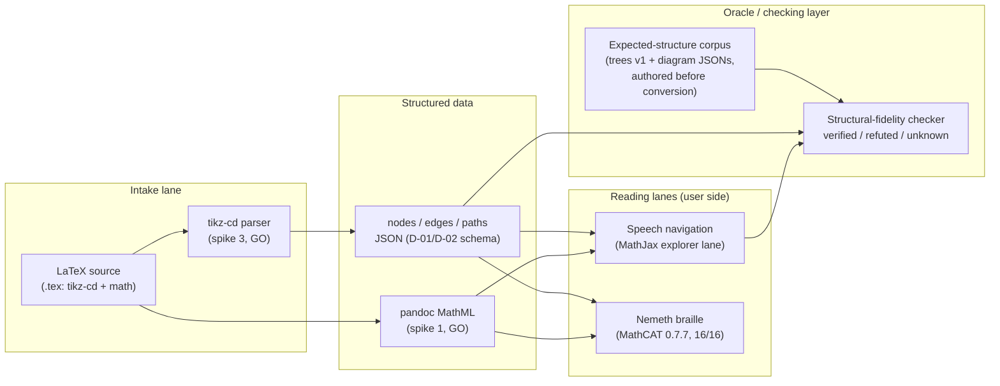
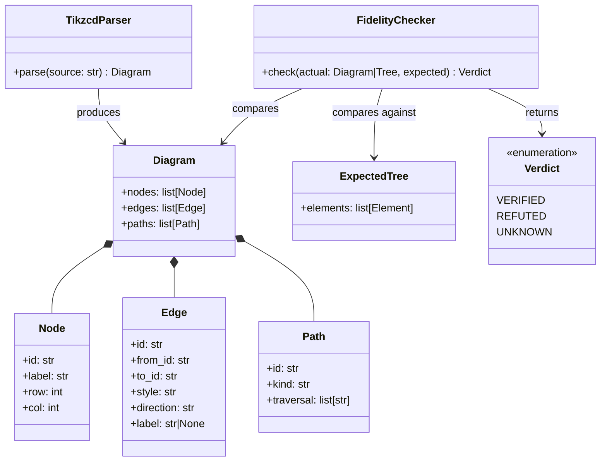

# Oracle — Draft Architecture and First Design Diagrams (v0)

**Date:** 2026-11-19 · **Status:** first draft for the A2 meeting and CW1 B6 ·
**Basis:** spikes 1–3 (all GO), corpus v1 + fixtures D-01/D-02, DEC-005
(Python intake/checking), DEC-006 (no AI in the deliverable), DEC-007
(three-valued answers). Diagrams are Mermaid sources — version-controlled
drafts; the portfolio pass (PB-19) redraws them to final quality.

## 1. Component architecture (the four layers)

Each lane was validated independently by a spike; this is the first diagram
that shows them as one system.



Key property (DEC-006): every box is deterministic; the only intelligence is
the human who authored the expected structures — which is why the corpus is
written *before* the converter runs (the blind-authoring discipline).

## 2. Class model (first draft)

Types are concrete today only where a spike or the checker exists; the rest
are the shape the next sprints fill in.



Notes: `Verdict` is the system's spine (DEC-007) — every comparison funnels
to three values, never a probability. The checker's tree half already exists
mechanically (`tools/tree_format_check.py`, 24/24 × 4 on corpus v1); its
diagram half is the spike-3 comparison function promoted to a component
(PB-11's work).

## 3. Reading session (sequence, first draft)

The user-side story the navigation cards (PB-08/PB-09) implement — and the
sequence the eventual evaluation observes.

```mermaid
sequenceDiagram
    participant R as Non-visual reader
    participant N as Navigator (speech/braille)
    participant D as Diagram (structured data)
    participant C as Checker
    R->>N: open document, reach a diagram
    N->>D: request overview
    D-->>N: "4 objects, 4 arrows, square grid; arrows: p_2, p_1, t, s"
    N-->>R: spoken/braille overview
    R->>N: go to object 1 / follow arrow p_2
    N->>D: traverse path (node, edge)
    D-->>N: node label + incident arrows in reading order
    N-->>R: "P — arrow p_2 to Y, arrow p_1 to X"
    R->>N: does this square commute?
    N->>C: check declared condition
    C-->>N: VERIFIED / REFUTED / UNKNOWN + basis
    N-->>R: three-valued answer with evidence
```

The last exchange is the differentiator: the reader can ask the checker a
question and trust the answer's honesty — UNKNOWN is an answer, never a
guess (the chain-eq FLAG in the author report is the worked example of why).

## 4. What this draft does not yet decide

- Speech-synthesis engine for the diagram lane (spike 1 validated MathML
  navigation in the browser; PB-08's overview sentence is not yet built).
- Where the checker lives at runtime (build-time report vs in-session
  query) — an elicitation question for the requirements record (PB-16).
- Storage format for corpora beyond files (a DB is not needed at current
  scale; revisit at the Sprint 2 review if fixture growth demands it).
